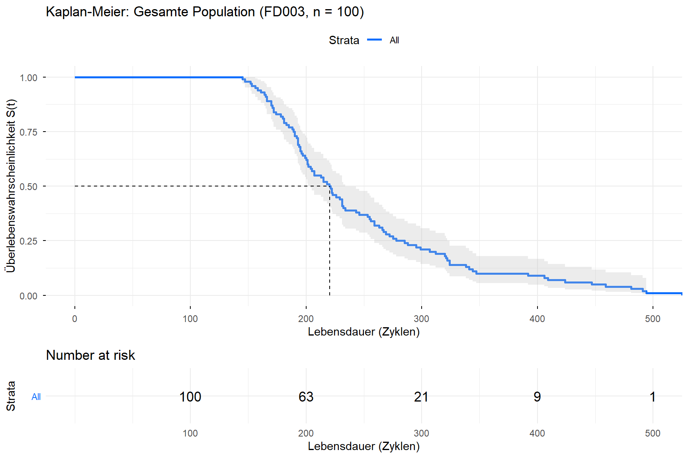
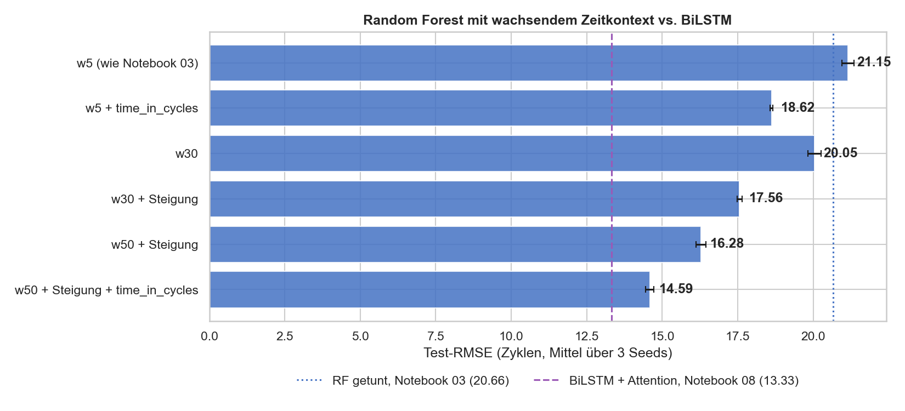
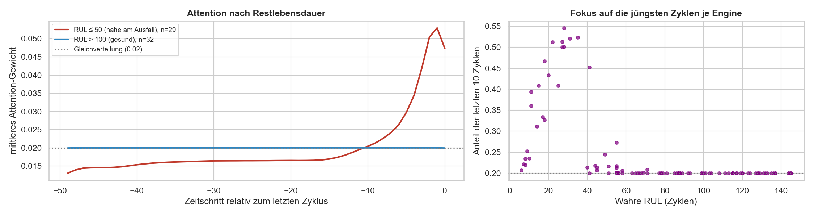

# Predictive Maintenance – NASA CMAPSS FD003

Restlebensdauer (RUL) von Turbofan-Triebwerken: Survival-Analyse in R, Machine Learning in Python.
Studienprojekt an der DHBW Lörrach (Data Science & AI), Juni 2026.

## English summary

- **Question.** How accurately can the remaining useful life (RUL) of turbofan engines be predicted from sensor data, and what do statistical survival models and machine-learning regressors each contribute?
- **Approach.** NASA CMAPSS FD003: 100 training engines run to failure, 100 truncated test engines, two unlabeled fault modes, 12 of 21 sensors kept after constancy and VIF filtering. Data preparation and survival analysis (Kaplan–Meier, Weibull AFT, Cox PH) in R with a Shiny dashboard. RUL regression in Python: Random Forest, XGBoost and SVR on rolling-window features, and a bidirectional LSTM with attention on 50-cycle sequences. Engine-wise GroupKFold cross-validation, RUL capped at 125 cycles.
- **Key results** (official test set, 100 engines). The BiLSTM with attention reaches an RMSE of 13.33 cycles and a NASA score of 265, compared with 20.72 and 2051 for the best tabular model (Random Forest). The three tabular models lie within 0.4 RMSE of each other. Survival analysis: median life 220.5 cycles, Weibull shape β = 2.93 (wear-out failures), bimodal lifetimes consistent with the two fault modes.
- **Learnings.**
  1. Temporal context matters most. A follow-up ablation shows that a Random Forest with a 50-cycle window, slope features and the cycle count reaches 14.59 RMSE and closes about 83 % of the gap to the BiLSTM.
  2. Cross-validation has to split by engine; row-wise splits leak information between cycles of the same engine.
  3. RMSE and the asymmetric NASA score can rank models differently, because the NASA score is dominated by a few large errors.
  4. The attention weights focus on the most recent ~10 cycles only when an engine is close to failure; for healthy engines they stay almost uniform.
- **Author.** Julian Haar – concept, implementation in R and Python, analyses and documentation.

The detailed documentation below and in the folder READMEs is in German.

## Projektüberblick

**Forschungsfrage:** Wie lässt sich die Remaining Useful Life (RUL) von Triebwerken modellieren – mit Survival Analysis im Vergleich zu ML-Methoden?

**Daten:** NASA CMAPSS FD003 – eine Betriebsbedingung, zwei Ausfallmodi (HPC- und Fan-Degradation, nicht gelabelt), 100 Trainings-Engines (bis zum Ausfall) und 100 Test-Engines (vorzeitig abgebrochen, wahre RUL separat). Von 21 Sensoren bleiben nach Konstanz-Filter und VIF-Check 12.

| Track | Sprache | Methoden | Ergebnisse |
|---|---|---|---|
| Statistik | R 4.5 (renv) | Kaplan-Meier, Weibull AFT, Cox PH | Quarto-Analysen, Shiny-Dashboard |
| Machine Learning | Python 3.13 (uv) | Random Forest, XGBoost, SVR, BiLSTM + Attention | Jupyter-Notebooks |

Die Datenaufbereitung läuft komplett in R (`statistik/analysis/02_preprocessing.qmd`); Python liest die fertigen CSVs aus `data/processed/`.

## Autor

Julian Haar – Konzeption, Umsetzung in R und Python, Analysen und Dokumentation.

## Ergebnisse

### Machine Learning – Test-Set (100 Engines)

| Modell | RMSE | MAE | R² | NASA Score |
|---|---:|---:|---:|---:|
| Random Forest | 20.72 | 15.40 | 0.749 | 2051.3 |
| XGBoost ¹ | 20.84 | 15.35 | 0.746 | 1940.5 |
| SVR (RBF) | 21.12 | 15.73 | 0.740 | 1809.1 |
| **BiLSTM + Attention** | **13.33** | **10.05** | **0.896** | **265.4** |

RMSE und MAE in Zyklen. Der NASA Score bestraft zu späte Prognosen stärker als zu frühe. Bei allen Metriken außer R² ist niedriger besser.

Werte des Originallaufs (Juni 2026, Windows). ¹ XGBoost wurde evaluiert, aber nicht in die finale Modellauswahl übernommen (Random Forest, SVR, BiLSTM + Attention); sein Ergebnis liegt zwischen RF und SVR. Ein Neulauf im Oktober 2026 auf macOS reproduziert SVR und BiLSTM exakt; RF und XGBoost weichen durch plattformabhängige Gleitkomma-Effekte um bis zu 0.4 RMSE ab. Die Notebooks zeigen den Neulauf, Details in [ml/README.md](ml/README.md).

### Statistik

- **Kaplan-Meier:** Median-Lebensdauer 220.5 Zyklen (95 %-KI 204–234). Die Lebensdauern sind bimodal verteilt, passend zu den zwei Ausfallmodi.
- **Weibull AFT:** Shape β = 2.93 > 1, also Verschleißausfälle mit steigender Ausfallrate.
- **Cox PH (statisch, Mittelwerte der letzten 20 Zyklen):** C-Index 0.756.



### Ergänzende Analysen (Oktober 2026)

**Woher kommt der Vorsprung des BiLSTM?** Notebook 09 gibt dem Random Forest schrittweise mehr Zeitkontext (3 Seeds je Variante). Mit 50-Zyklen-Fenster, Steigungs-Features und `time_in_cycles` sinkt der Test-RMSE von 21.15 auf 14.59 ± 0.14. Damit schließt sich rund 83 % des Abstands zwischen dem getunten Random Forest und dem BiLSTM.



**Worauf achtet das Attention-Modell?** Bei gesunden Engines (wahre RUL > 100) ist die Attention über das 50-Zyklen-Fenster fast gleichverteilt (Anteil der letzten 10 Zyklen: Median 0.20). Nahe am Ausfall (RUL ≤ 50) steigt dieser Anteil auf 0.33 (Median); zwischen Fokus und wahrer RUL besteht eine Rangkorrelation von ρ = −0.78 (Spearman).



## Struktur

```
statistik/                R: Statistik und Survival-Analyse
├── analysis/             Quarto-Analysen 01–05 und gerenderte HTML-Berichte
├── shiny-app/            Shiny-Dashboard (R/data_loader.R lädt Roh- und aufbereitete Daten)
├── reports/figures/      Abbildungen
└── README.md             Methoden, Ergebnisse, Setup
ml/                       Python: Machine Learning
├── notebooks/            03 RF · 04 XGBoost · 05 SVR · 06 Vergleich · 07 Beispiele · 08 BiLSTM · 09 Kontext-Ablation
├── src/                  Konfiguration, Daten-Loader, Metriken, Ergebnisdateien
├── scripts/              run_all.sh (alle Notebooks headless), Export für die Projektseite
├── reports/              Ergebnisse (JSON/CSV), Abbildungen, BiLSTM-Checkpoint
└── README.md             Methoden, Ergebnisse, Reproduzierbarkeit
data/
├── processed/            von R erzeugt, eingecheckt (train.csv, test.csv, feature_metadata.json)
├── raw/                  NASA-Rohdaten, nicht eingecheckt (siehe Daten)
└── README.md
```

## Daten

Die Rohdaten stammen aus dem Data Set Repository des NASA Prognostics Center of Excellence (PCoE), Datensatz „Turbofan Engine Degradation Simulation“ (CMAPSS).

- Übersicht: [NASA PCoE Data Set Repository](https://www.nasa.gov/intelligent-systems-division/discovery-and-systems-health/pcoe/pcoe-data-set-repository/)
- Direkter Download (ZIP): [6. Turbofan Engine Degradation Simulation Data Set](https://phm-datasets.s3.amazonaws.com/NASA/6.+Turbofan+Engine+Degradation+Simulation+Data+Set.zip)
- Mirror der PHM Society: [data.phmsociety.org/nasa](https://data.phmsociety.org/nasa/)
- Alternativ über Kaggle: `kaggle datasets download -d behrad3d/nasa-cmaps -p data/raw/ --unzip`

`train_FD003.txt`, `test_FD003.txt` und `RUL_FD003.txt` gehören nach `data/raw/CMaps/`. Gebraucht werden sie für die Quarto-Analysen und die ML-Notebooks 08 und 09. Die Notebooks 03–07 und die Shiny-App lesen die eingecheckten Dateien in `data/processed/`. Ein Neulauf von `02_preprocessing.qmd` (Oktober 2026) liefert dieselben Dateien bis auf Gleitkomma-Rundung (Abweichung höchstens 2.4·10⁻¹¹), mehr dazu in [data/README.md](data/README.md).

**Zitation**

- A. Saxena und K. Goebel (2008): *Turbofan Engine Degradation Simulation Data Set.* NASA Prognostics Data Repository, NASA Ames Research Center, Moffett Field, CA.
- A. Saxena, K. Goebel, D. Simon und N. Eklund (2008): *Damage Propagation Modeling for Aircraft Engine Run-to-Failure Simulation.* International Conference on Prognostics and Health Management (PHM08), Denver, CO.

## Setup

### Statistik (R)

```r
# R-Sitzung im Ordner statistik/ starten
install.packages("renv")
renv::restore()             # Pakete aus renv.lock (R 4.5.1)
shiny::runApp("shiny-app")  # Dashboard
```

Die Quarto-Analysen unter `statistik/analysis/` brauchen zusätzlich die Rohdaten in `data/raw/CMaps/`. Stolpersteine beim Setup: [statistik/README.md](statistik/README.md#12-setup-und-stolpersteine).

### Machine Learning (Python)

```bash
cd ml
uv sync              # Umgebung aus pyproject.toml und uv.lock (Python ≥ 3.12)
uv run jupyter lab   # Notebooks 03–09
```

Alle Notebooks in der richtigen Reihenfolge headless ausführen (ca. 30–60 min):

```bash
cd ml && bash scripts/run_all.sh
```

Das Skript legt eine eigene Umgebung `ml/.venv-mac` mit Python 3.13 an. Notebook 08 lädt standardmäßig den trainierten Checkpoint `ml/reports/lstm_best.keras` (`RETRAIN = False`). Auf macOS braucht XGBoost `libomp` (`brew install libomp`).

## Dokumentation

- [ml/README.md](ml/README.md) – ML-Teil: Features, Modelle, Metriken, Ergebnisse, Reproduzierbarkeit
- [statistik/README.md](statistik/README.md) – Statistik-Teil: EDA, Kaplan-Meier, Weibull AFT, Cox PH, Setup
- [statistik/shiny-app/README.md](statistik/shiny-app/README.md) – Dashboard
- [data/README.md](data/README.md) – Rohdaten, Aufbereitung, Reproduzierbarkeit

## Lizenz

Der Quellcode steht unter der [MIT-Lizenz](LICENSE). Die CMAPSS-Daten stammen von der NASA (Zitation siehe oben).
