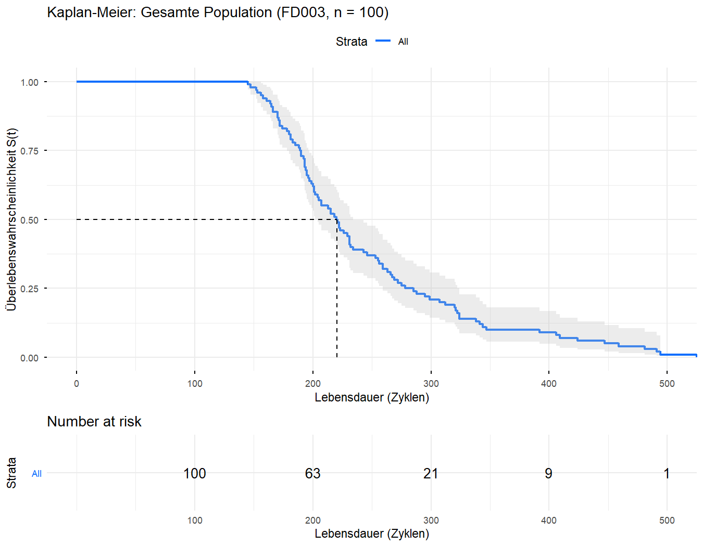
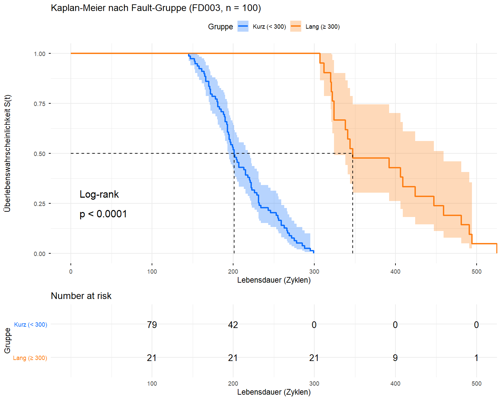
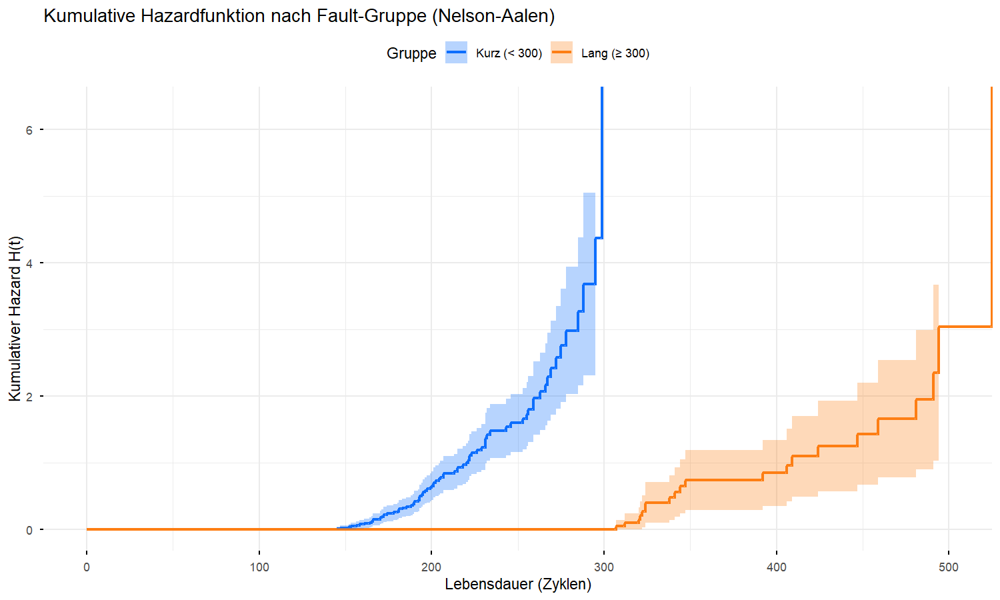

## Setup
```{r setup-dir, include=FALSE}
knitr::opts_knit$set(root.dir = normalizePath(".."))
```

```{r}

# renv mit absolutem Pfad aktivieren (relativ zur qmd-Datei, nicht root.dir)
renv_path <- file.path(dirname(knitr::current_input(dir = TRUE)), 
                       "..", "renv", "activate.R")
source(renv_path)
source("shiny-app/R/data_loader.R")

library(tidyverse)
library(survival)    # Surv(), survfit(), survdiff()
library(survminer)   # ggsurvplot()
library(kableExtra)

library(conflicted)
conflict_prefer("select", "dplyr")
conflict_prefer("filter", "dplyr")

source("shiny-app/R/data_loader.R")

# Trainingsdaten laden (alle Engines laufen bis zum echten Ausfall → keine Zensierung)
train <- load_train_fd003(base_path = "../data/raw/CMaps")

cat("Training:", nrow(train), "Zeilen,", n_distinct(train$unit_number), "Engines\n")
```

```
Training: 24720 Zeilen, 100 Engines
```
---

## 1. Datenvorbereitung: Lebensdauer pro Engine

Für Kaplan-Meier brauchen wir **eine Zeile pro Engine** mit ihrer Gesamtlebensdauer.
Im Trainingsdatensatz ist das der maximale Zyklus der jeweiligen Engine.

Da alle Engines bis zum echten Ausfall beobachtet wurden, ist das Event-Flag für
jede Engine 1 (= Ausfall beobachtet, keine Zensierung).

```{r}
# Eine Zeile pro Engine: Gesamtlebensdauer + Event-Flag
lifetimes <- train %>%
  group_by(unit_number) %>%
  summarise(lifetime = max(time_in_cycles)) %>%
  ungroup() %>%
  mutate(
    # event = 1: Ausfall beobachtet (kein censoring im Training)
    event = 1L,

    # Subgruppen basierend auf EDA-Erkenntnis:
    # Bimodale Verteilung mit Gap zwischen ~350 und ~400 Zyklen
    # Schwellwert 300 liegt klar zwischen den zwei Clustern
    fault_group = if_else(lifetime < 300, "Kurz  (< 300)", "Lang  (≥ 300)")
  )

# Übersicht
cat("Engines gesamt:         ", nrow(lifetimes), "\n")
cat("Gruppe 'Kurz (< 300)':  ", sum(lifetimes$fault_group == "Kurz  (< 300)"), "Engines\n")
cat("Gruppe 'Lang (≥ 300)':  ", sum(lifetimes$fault_group == "Lang  (≥ 300)"), "Engines\n\n")

# Deskriptive Kennzahlen pro Gruppe
lifetimes %>%
  group_by(fault_group) %>%
  summarise(
    n        = n(),
    min      = min(lifetime),
    median   = median(lifetime),
    mean     = round(mean(lifetime), 1),
    max      = max(lifetime),
    sd       = round(sd(lifetime), 1)
  ) %>%
  kable(caption = "Lebensdauer-Kennzahlen nach Fault-Gruppe") %>%
  kable_styling(bootstrap_options = c("striped", "hover"))
```

```
Engines gesamt:          100 
Gruppe 'Kurz (< 300)':   79 Engines
Gruppe 'Lang (≥ 300)':   21 Engines
```

| fault_group    | n  | min | median | mean  | max | sd   |
|----------------|----|-----|--------|-------|-----|------|
| Kurz (< 300)   | 79 | 152 | 201    | 206.1 | 295 | 30.5 |
| Lang (≥ 300)   | 21 | 301 | 347    | 376.8 | 525 | 61.2 |

**Interpretation:** Die zwei Gruppen unterscheiden sich bereits deskriptiv stark —
der Median der langen Gruppe (347 Zyklen) liegt rund 70% höher als der der kurzen
Gruppe (201 Zyklen). Das ist ein erster Hinweis auf zwei strukturell verschiedene
Subpopulationen. Der Log-Rank-Test in Abschnitt 4 prüft das formal.

---

## 2. Kaplan-Meier Schätzer: Gesamte Population

Zunächst schätzen wir die Überlebensfunktion für alle 100 Engines gemeinsam.

Das `Surv()`-Objekt kodiert für jede Engine: "wie lange hat sie gelebt, und ist sie
wirklich ausgefallen?" Die Tilde-1-Notation (`~ 1`) bedeutet: keine Gruppenaufteilung,
eine gemeinsame Kurve.

```{r}
# Kaplan-Meier für alle Engines (keine Gruppenaufteilung)
km_gesamt <- survfit(Surv(lifetime, event) ~ 1, data = lifetimes)

summary(km_gesamt)$table %>%
  as.data.frame() %>%
  kable(digits = 2,
        caption = "KM-Gesamtschätzer: Zusammenfassung") %>%
  kable_styling(bootstrap_options = c("striped", "hover"))
```

```{r}
#| fig-width: 9
#| fig-height: 6

p_gesamt <- ggsurvplot(
  km_gesamt,
  data          = lifetimes,
  conf.int      = TRUE,              # 95%-Konfidenzband
  risk.table    = TRUE,              # "Number at risk"-Tabelle darunter
  risk.table.height = 0.25,
  xlab          = "Lebensdauer (Zyklen)",
  ylab          = "Überlebenswahrscheinlichkeit S(t)",
  title         = "Kaplan-Meier: Gesamte Population (FD003, n = 100)",
  surv.median.line = "hv",          # Horizontale/vertikale Linie beim Median
  palette       = "#0d6efd",
  ggtheme       = theme_minimal()
)

print(p_gesamt)

# Abbildung speichern
png("reports/figures/km_gesamt.png", width = 9, height = 7,
    units = "in", res = 150)
print(p_gesamt)
dev.off()
```



**Ergebnis:** Median-Lebensdauer = **220.5 Zyklen** [95%-KI: 204 – 234].
Number at risk: 100 → 63 → 21 → 9 → 1 (bei Zyklen 100 / 200 / 300 / 400 / 500).

**Interpretation:**

- Die KM-Kurve fällt treppenförmig ab — jede Stufe entspricht einem oder mehreren
  Ausfällen bei demselben Zyklus.
- Das **Konfidenzband** wird gegen Ende breiter, weil immer weniger Engines beobachtet
  werden und die Schätzung unsicherer wird.
- Die **Medianlebensdauer** liegt bei 220.5 Zyklen — Hälfte der Engines hat zu
  diesem Zeitpunkt bereits versagt.
- Der unregelmäßige Verlauf deutet auf Heterogenität in der Population hin —
  die Subgruppenanalyse in Abschnitt 3 deckt das auf.


---

## 3. Kaplan-Meier Schätzer: Subgruppen (kurze vs. lange Lebensdauer)

Die bimodale Verteilung aus der EDA legt nahe, dass zwei verschiedene Ausfallmechanismen
vorliegen. Wir teilen die Population an der Grenze von 300 Zyklen auf.

```{r}
# KM nach Fault-Gruppe (Tilde-fault_group → separate Kurve pro Gruppe)
km_gruppen <- survfit(Surv(lifetime, event) ~ fault_group, data = lifetimes)

# Medianlebensdauern pro Gruppe mit Konfidenzintervall
km_summary <- surv_median(km_gruppen)
km_summary %>%
  kable(digits = 1,
        caption = "Median-Überlebenszeit pro Gruppe (mit 95%-KI)") %>%
  kable_styling(bootstrap_options = c("striped", "hover"))
```

```
                           median  lower  upper
fault_group=Kurz (< 300)     201    194    220
fault_group=Lang (≥ 300)     347    324    459
```

```{r}
#| fig-width: 10
#| fig-height: 7

# Farben: Blau für kurze Lebensdauer, Orange für lange

p_gruppen <- ggsurvplot(
  km_gruppen,
  data              = lifetimes,
  conf.int          = TRUE,
  risk.table        = TRUE,
  risk.table.height = 0.28,
  pval              = TRUE,          # p-Wert des Log-Rank-Tests direkt im Plot
  pval.method       = TRUE,          # Testbezeichnung anzeigen
  xlab              = "Lebensdauer (Zyklen)",
  ylab              = "Überlebenswahrscheinlichkeit S(t)",
  title             = "Kaplan-Meier nach Fault-Gruppe (FD003, n = 100)",
  legend.title      = "Gruppe",
  legend.labs       = c("Kurz (< 300)", "Lang (≥ 300)"),
  surv.median.line  = "hv",
  palette           = c("#0d6efd", "#fd7e14"),
  ggtheme           = theme_minimal()
)

print(p_gruppen)

png("reports/figures/km_gruppen.png", width = 10, height = 8,
    units = "in", res = 150)
print(p_gruppen)
dev.off()
```



**Interpretation:**

- Die zwei KM-Kurven trennen sich **früh und klar** — bereits ab Zyklus ~150 liegt
  die kurze Gruppe deutlich unter der langen.
- Die **Konfidenzintervalle überlappen nicht**, was die visuelle Trennung statistisch
  untermauert.
- Median kurze Gruppe: **201 Zyklen** [194 – 220], lange Gruppe: **347 Zyklen** [324 – 459].
- Das unterstützt die Hypothese zweier verschiedener Ausfallmechanismen:
  HPC-Degradation (schneller) und Fan-Degradation (langsamer).

---

## 4. Log-Rank-Test: Statistischer Nachweis

Der Log-Rank-Test prüft formal, ob die beobachteten Unterschiede zwischen den zwei
KM-Kurven durch Zufall entstanden sein könnten.

**Hypothesen:**

- H₀: Beide Gruppen haben dieselbe Überlebensfunktion — kein Unterschied zwischen
  den Fault Modes
- H₁: Die Überlebensfunktionen unterscheiden sich signifikant

```{r}
# Log-Rank-Test
logrank_test <- survdiff(Surv(lifetime, event) ~ fault_group, data = lifetimes)

print(logrank_test)
```

```
Call:
survdiff(formula = Surv(lifetime, event) ~ fault_group, data = lifetimes)

                           N Observed Expected (O-E)^2/E (O-E)^2/V
fault_group=Kurz  (< 300) 79       79     46.7      22.3      64.6
fault_group=Lang  (≥ 300) 21       21     53.3      19.5      64.6

 Chisq= 64.6  on 1 degrees of freedom, p= 9e-16
```

```{r}
# p-Wert extrahieren und einordnen
p_wert <- 1 - pchisq(logrank_test$chisq, df = length(logrank_test$n) - 1)

cat("=== Log-Rank-Test Ergebnis ===\n\n")
cat("Chi-Quadrat-Statistik:", round(logrank_test$chisq, 2), "\n")
cat("Freiheitsgrade:        ", length(logrank_test$n) - 1, "\n")
cat("p-Wert:                ", format(p_wert, scientific = TRUE, digits = 3), "\n\n")

if (p_wert < 0.001) {
  cat("→ Hoch signifikant (p < 0.001): H₀ wird verworfen.\n")
  cat("  Die zwei Gruppen entstammen statistisch verschiedenen Populationen.\n")
} else if (p_wert < 0.05) {
  cat("→ Signifikant (p < 0.05): H₀ wird verworfen.\n")
} else {
  cat("→ Nicht signifikant (p ≥ 0.05): H₀ kann nicht verworfen werden.\n")
}
```

```
=== Log-Rank-Test Ergebnis ===

Chi-Quadrat-Statistik: 64.62 
Freiheitsgrade:         1 
p-Wert:                 8.88e-16 

→ Hoch signifikant (p < 0.001): H₀ wird verworfen.
  Die zwei Gruppen entstammen statistisch verschiedenen Populationen.
```

```{r}
# Beobachtete vs. erwartete Ausfälle pro Gruppe (Tabellenform)
data.frame(
  Gruppe     = names(logrank_test$n),
  N          = logrank_test$n,
  Beobachtet = logrank_test$obs,
  Erwartet   = round(logrank_test$exp, 2),
  `Obs/Exp`  = round(logrank_test$obs / logrank_test$exp, 2),
  check.names = FALSE
) %>%
  kable(caption = "Log-Rank-Test: Beobachtete vs. erwartete Ausfälle") %>%
  kable_styling(bootstrap_options = c("striped", "hover"))
```

```
                           N   Beobachtet  Erwartet  Obs/Exp
fault_group=Kurz (< 300)  79  79          46.70     1.69
fault_group=Lang (≥ 300)  21  21          53.30     0.39
```

**Interpretation:**

- p = 8.88e-16 — H₀ wird klar verworfen.
- In der kurzen Gruppe treten Ausfälle **früher** als erwartet auf (Obs/Exp = 1.69),
  in der langen **später** (Obs/Exp = 0.39) — genau das Muster bei zwei verschiedenen
  Ausfallmechanismen.
- **Einschränkung:** Der Schwellwert 300 Zyklen wurde post-hoc aus der EDA abgeleitet
  — der Test ist exploratorisch, nicht konfirmatorisch.

---

## 5. Kumulative Hazard-Funktion (Nelson-Aalen)

Ergänzend zur Überlebensfunktion zeigt die kumulative Hazardfunktion H(t), wie sich
das akkumulierte Ausfallrisiko über die Zeit aufbaut. Bei einem konstanten Risiko
(Exponentialverteilung) wäre H(t) eine Gerade. Eine konvexe Kurve (wie bei uns zu
erwarten) bedeutet steigendes Risiko mit zunehmendem Alter — Verschleißausfall.

```{r}
#| fig-width: 10
#| fig-height: 6

p_hazard <- ggsurvplot(
  km_gruppen,
  data          = lifetimes,
  fun           = "cumhaz",          # kumulative Hazardfunktion statt S(t)
  conf.int      = TRUE,
  xlab          = "Lebensdauer (Zyklen)",
  ylab          = "Kumulativer Hazard H(t)",
  title         = "Kumulative Hazardfunktion nach Fault-Gruppe (Nelson-Aalen)",
  legend.title  = "Gruppe",
  legend.labs   = c("Kurz (< 300)", "Lang (≥ 300)"),
  palette       = c("#0d6efd", "#fd7e14"),
  ggtheme       = theme_minimal()
)

print(p_hazard)

png("reports/figures/km_hazard.png", width = 10, height = 6,
    units = "in", res = 150)
print(p_hazard)
dev.off()
```



**Interpretation:**

- Beide Kurven steigen **konvex** an — Verschleißcharakter bestätigt (β > 1),
  konsistent mit dem Weibull-Fit aus der EDA.
- Die kurze Gruppe akkumuliert Risiko deutlich schneller bis ca. 300 Zyklen.
- Diese Kurven motivieren das Weibull AFT-Modell in `04_survival_weibull.qmd`.

---

## 6. Zusammenfassung

```{r}
cat("=== Zusammenfassung: Kaplan-Meier Analyse (FD003) ===\n\n")

cat("DATASET:\n")
cat("  Engines analysiert:    100 (alle Training-Engines)\n")
cat("  Zensierte Beobacht.:   0 (alle Engines bis Ausfall beobachtet)\n\n")

cat("GESAMTPOPULATION:\n")
km_med <- surv_median(km_gesamt)
cat("  Median-Lebensdauer:   ", km_med$median, "Zyklen\n")
cat("  95%-KI:               [", km_med$lower, ",", km_med$upper, "]\n\n")

cat("SUBGRUPPEN (Schwellwert: 300 Zyklen):\n")
km_med_g <- surv_median(km_gruppen)
for (i in seq_len(nrow(km_med_g))) {
  cat(sprintf("  %-20s Median: %4d  [%4d, %4d]\n",
              km_med_g$strata[i],
              km_med_g$median[i],
              km_med_g$lower[i],
              km_med_g$upper[i]))
}

cat("\nLOG-RANK-TEST:\n")
cat("  Chi²:", round(logrank_test$chisq, 2),
    "  p-Wert:", format(p_wert, scientific = TRUE, digits = 3), "\n")
cat("  Ergebnis: Hochsignifikanter Unterschied zwischen den Gruppen\n\n")

cat("SCHLUSSFOLGERUNGEN:\n")
cat("  1. Die bimodale Lebensdauerverteilung aus der EDA entspricht\n")
cat("     zwei statistisch trennbaren Subpopulationen.\n")
cat("  2. Der Verschleißcharakter (konvexe H(t)) rechtfertigt die\n")
cat("     Weibull-Modellierung in 04_survival_weibull.qmd.\n")
cat("  3. Die fehlende Gruppenüberlappung motiviert die Aufnahme\n")
cat("     von Sensor-Covariaten im Cox PH Modell (05_survival_cox.qmd).\n")
```

```
=== Zusammenfassung: Kaplan-Meier Analyse (FD003) ===

GESAMTPOPULATION:
  Median-Lebensdauer:    220.5 Zyklen
  95%-KI:               [ 204 , 234 ]

SUBGRUPPEN (Schwellwert: 300 Zyklen):
  fault_group=Kurz  (< 300)           Median:  201  [ 194,  220]
  fault_group=Lang  (≥ 300)           Median:  347  [ 324,  459]

LOG-RANK-TEST:
  Chi²: 64.62   p-Wert: 8.88e-16 
  Ergebnis: Hochsignifikanter Unterschied zwischen den Gruppen

SCHLUSSFOLGERUNGEN:
  1. Bimodale Lebensdauerverteilung = zwei statistisch trennbare Subpopulationen
  2. Konvexer H(t)-Verlauf → Weibull-Modellierung gerechtfertigt
  3. Gruppenunterschied motiviert Sensor-Covariaten in Cox PH
```
---

## Methodische Einschränkungen

- **Kein echter Zensierungsvorteil:** Da alle Training-Engines bis zum Ausfall
  beobachtet wurden, hätte ein simples Histogramm ähnliche Aussagen geliefert.
  Der Mehrwert von KM liegt hier im formalen Rahmen und in der Vorbereitung für
  Cox PH, das Zensierung konsequent nutzt.

- **Explorativer Schwellwert:** Die Grenze von 300 Zyklen wurde post-hoc aus
  der EDA abgeleitet. Eine unabhängige Validierung (z.B. mit externen Fault-Mode-Labels)
  wäre für echte Konfirmation nötig.

- **Nur eine Betriebsbedingung:** FD003 hat eine einzige Operating Condition.
  In FD002/FD004 mit sechs Bedingungen wäre die Subgruppenanalyse komplexer und
  die Konfundierung schwerer kontrollierbar.

- **Nächster Schritt:** `04_survival_weibull.qmd` — Weibull AFT-Modell mit
  Sensor-Covariaten, um den parametrischen Zusammenhang zwischen Sensorzustand
  und Überlebenszeit zu schätzen.
